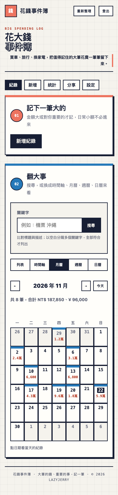
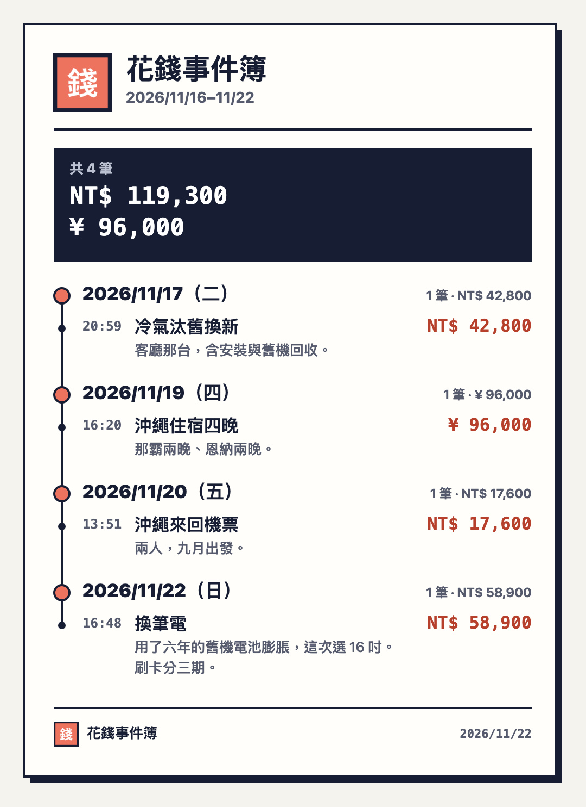
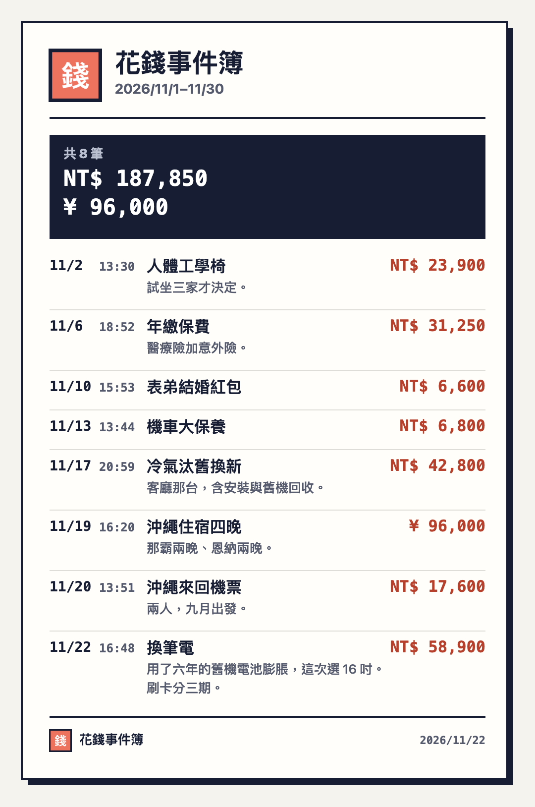
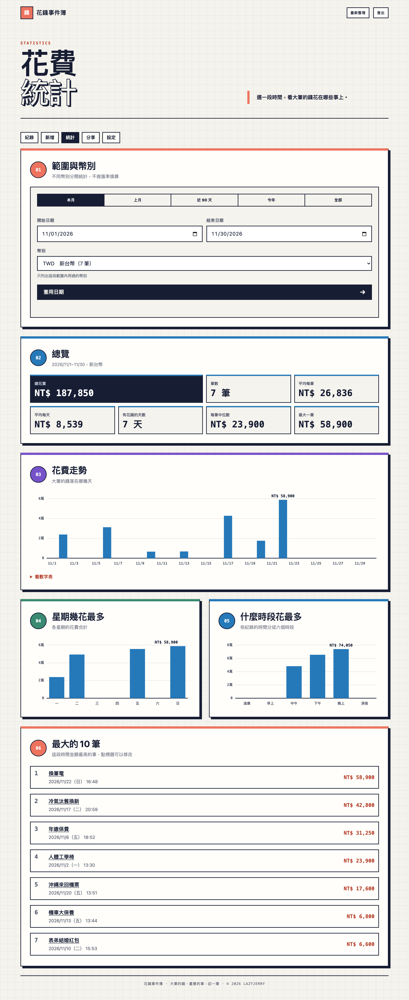

# 花錢事件簿

[](https://deploy.workers.cloudflare.com/?url=https://github.com/lazyjerry/spendbook)

花大錢的事件紀錄。只記金額大、或對你重要的那幾筆——買車、旅行、換家電、紅包、學費——留下花在哪件事、花了多少、什麼時候、為什麼，附一張收據或實物的照片。日常小額不是它要管的，這不是逐筆記帳的帳本。

之後用列表、時間軸、月曆、週曆、日曆回頭翻，看大筆的錢都花在哪些事上，或把一段期間做成圖片、文字分享出去。跑在 Cloudflare Workers，紀錄存 D1，壓縮後的照片存 R2，可以安裝成 PWA。

## 畫面

| 月曆（手機） | 分享圖：時間軸 | 分享圖：列表 |
|---|---|---|
|  |  |  |



畫面中的紀錄都是虛構的示範資料。

## 適合記什麼

| 適合 | 不適合 |
|---|---|
| 一筆就有感的花費：3C、家電、家具、機票住宿、保險、學費、紅包、修車 | 每天的三餐、飲料、交通 |
| 想記住來龍去脈的事：為什麼買、在哪買、值不值得 | 需要分類、預算、收支結餘的記帳 |
| 隔幾年還想翻出來看的事 | 多人分帳、對帳 |

金額多大才算「大」由你自己決定，工具不設門檻。

## 功能

| 頁面 | 路徑 | 內容 |
|---|---|---|
| 紀錄 | `/` | 搜尋標題與描述（多個關鍵字以空白分隔）；五種檢視：列表、時間軸、月曆、週曆、日曆。月曆點日期進當天的日曆 |
| 新增／修改 | `/edit`、`/edit?id=…` | 哪件事（標題）、幣別與金額、時間（預設現在，可改）、來龍去脈（描述，0–1024 字）、照片（選填，一筆一張）；修改頁可刪除 |
| 統計 | `/stats` | 選日期範圍與幣別：總花費、筆數、平均與中位數、大筆的錢落在哪幾天或哪幾個月、星期與時段分布、金額最大的 10 筆 |
| 分享 | `/share` | 選日期範圍（可加關鍵字），做成時間軸圖、列表圖或純文字；圖片帶 App 標誌，可用系統分享、下載或複製 |
| 設定 | `/settings` | 稱呼、預設幣別、一週從哪天開始、照片長邊與 JPEG 品質；通行金鑰管理、密碼登入開關、修改帳號與密碼 |

- **幣別**：新台幣、日圓、美元等 14 種，金額以最小單位的整數保存。不同幣別分開合計，不做匯率換算。
- **照片**：在瀏覽器縮到設定的長邊、轉成 JPEG 並移除 EXIF 後才上傳，原始檔不離開裝置。
- **登入**：帳號密碼或通行金鑰（WebAuthn）。密碼以 PBKDF2-SHA256 雜湊保存；同一個來源 15 分鐘內密碼登入最多嘗試 10 次。
- **時區**：時間以 UTC 保存，畫面依裝置時區顯示與分組。
- **多人**：資料表與照片都以帳號隔離，但目前只有一個帳號，沒有註冊畫面。

## 部署

按上面的 Deploy to Cloudflare，會建立 Worker、D1、R2 並要求填 `APP_PASSWORD`。或手動：

```bash
npm install
npx wrangler d1 create spendbook-db          # 把回傳的 database_id 填進 wrangler.jsonc（或 wrangler.local.jsonc）
npx wrangler r2 bucket create spendbook-photos
npx wrangler secret put APP_PASSWORD         # 長一點的隨機字串
npm run deploy
```

- `APP_PASSWORD` 是第一次登入用的密碼，也是登入 cookie 的簽章金鑰。更換它會讓所有裝置登出。
- 第一次登入：帳號 `admin`、密碼是 `APP_PASSWORD`。登入後會直接帶到設定頁的「帳號與密碼」，每一頁上方也會提示，直到改過密碼為止；改完之後密碼只存在 D1。
- `npm run deploy` 會先套用 D1 migration 再部署。專案根有 `wrangler.local.jsonc` 時用它（不進版控，適合放自己的資料庫編號與自訂網域），沒有就用 `wrangler.jsonc`。
- 通行金鑰綁定網域。換網域後原本的金鑰不能用，要在新網域用密碼登入後重新新增；在那之前不要關閉密碼登入。

### 忘記密碼

把帳號的密碼雜湊清掉，就能再用 `APP_PASSWORD` 登入：

```bash
npx wrangler d1 execute DB --remote --command "UPDATE users SET password_hash = NULL WHERE username = '<帳號>'"
```

密碼登入被關掉、通行金鑰又不見時，先打開密碼登入：

```bash
npx wrangler d1 execute DB --remote --command "UPDATE auth_config SET password_login = 1 WHERE id = 1"
```

## 本機開發

```bash
npm install
cp .dev.vars.example .dev.vars    # 改掉 APP_PASSWORD
npm run migrate:local
npm run dev                       # http://localhost:8787，帳號 admin、密碼是 .dev.vars 的 APP_PASSWORD
```

通行金鑰在本機要用 `localhost` 開（IP 不能當 RP ID）。

| 指令 | 用途 |
|---|---|
| `npm run pages` | 由 `scripts/pages/` 重新產生 `public/*.html` |
| `npm run icons` | 重新產生 PWA icon 與 favicon（需要 Pillow，macOS 字型） |
| `npm run vendor` | 把 SimpleWebAuthn 前端複製到 `public/vendor/` |
| `npm run check` | 重產頁面、Jerry UI 規範（有裝 `build-jerry-cloudflare-page` skill 時）、JS 語法、頁面引用、PWA 檔案檢查 |
| `npm test` | 上一項加 API 冒煙測試（自己起一個用暫存資料庫的 `wrangler dev`） |

## 專案結構

| 路徑 | 內容 |
|---|---|
| `src/index.js` | 路由：未登入只放行登入頁需要的檔案；`/api/*`、`/media/*`、靜態頁 |
| `src/auth.js`、`src/password.js` | 帳號密碼登入、登入次數限制、session cookie、修改帳號與密碼 |
| `src/passkey.js` | 通行金鑰註冊、登入、刪除，密碼登入開關 |
| `src/db.js` | 紀錄與設定的驗證與 D1 查詢 |
| `src/media.js` | 照片上傳、讀取、刪除（R2） |
| `migrations/` | D1 資料表 |
| `scripts/pages/`、`scripts/build_pages.py` | 各頁內文與頁面殼產生腳本 |
| `public/` | 產出的頁面、樣式（`jerry-ui.css` 與 `app.css`）、各頁腳本（`js/`）、PWA 檔案 |

## 授權

MIT，見 [LICENSE](LICENSE)。通行金鑰使用 [SimpleWebAuthn](https://github.com/MasterKale/SimpleWebAuthn)（MIT）。
